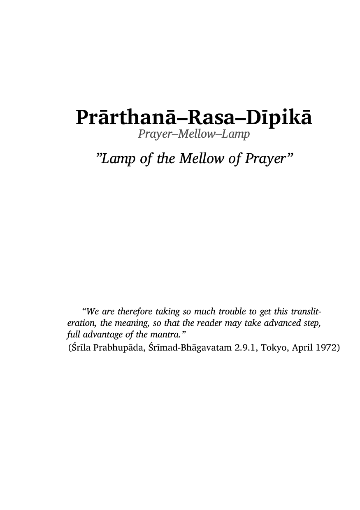
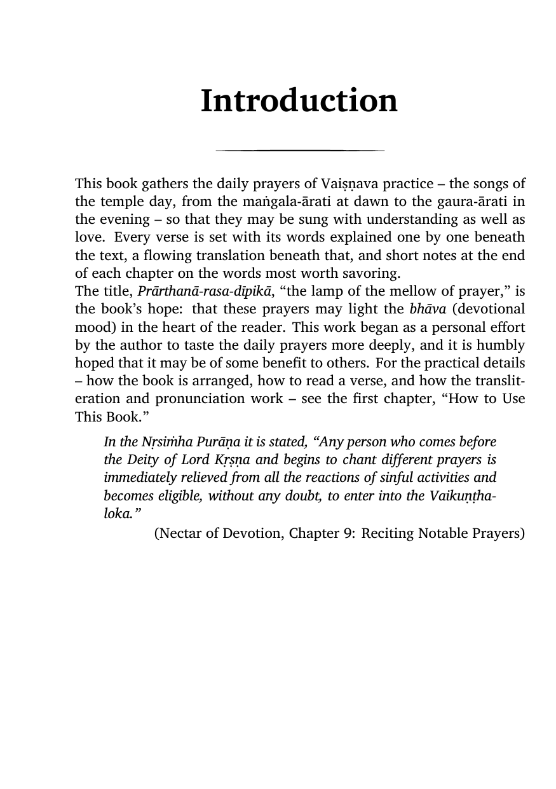
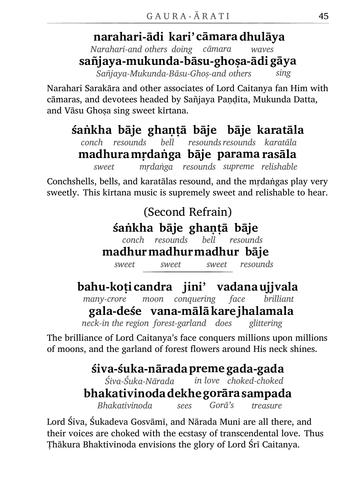

# Songbook

[](https://go.dev)
[](https://github.com)
[](LICENSE)
[](https://www.luatex.org)

A Vaiṣṇava prayer-songbook PDF generator. A Go binary reads YAML content
files, renders them through Go templates into LaTeX, and compiles the
result with LuaLaTeX into a print-ready PDF — including a saddle-stitched
A5 booklet imposition.

## 30-second example

Each song is a YAML verse of word-by-word entries (`data/verse/*.yaml`):

```yaml
title: Gaura-ārati
author: Bhaktivinoda Ṭhākura
language: bn
slokas:
  - number: 1
    padas:
      - entries:
          - {word: (kiba), gloss: oh how}
          - {word: jaya, gloss: glory}
          - {word: gorācāṅder, gloss: Gorācānd's}
          - {word: āratika, gloss: ārati's}
          - {word: śobhā, gloss: splendor}
    translation: |-
      All glories, all glories to the beautiful ārati ceremony of Lord Caitanya.
```

```sh
make generate   # YAML → LaTeX in out/book.tex + out/chapters/*.tex
make            # …then LuaLaTeX (twice) → out/book.pdf
```

## Sample output

| Title page | Introduction | Verse with word-by-word gloss |
|---|---|---|
|  |  |  |

## Prerequisites

- Go toolchain
- LuaLaTeX (`lualatex`) with the `Charis SIL` font
- `Noto Serif Bengali` font (renders Bengali letters such as ড়, ড in the
  transliteration guide)
- `yamlfmt` — YAML formatter (run after editing `.yaml` files)

## Commands

```sh
make                # generate LaTeX from YAML, then lualatex (twice)
make generate       # YAML → LaTeX only (go run ./cmd/songbook)
make out/book.pdf   # LaTeX → PDF only (generate runs first as a make dependency)
make booklet        # impose out/book.pdf into an A5 saddle-stitched booklet (A4 landscape sheets)
make clean          # rm -rf out/
make test           # go test ./...
make lint           # gofmt check + go vet
make fmt            # gofmt -w .
```

Tests: `go test ./internal/generator/ -v`

## Project layout

```
cmd/songbook/main.go   # CLI (flags: -data, -templates, -out)
internal/generator/    # types.go (data model), load.go (YAML loading), render.go (text/template rendering)
data/book.yaml         # title, intro, chapters list, book-level fragments
data/chapters/*.yaml   # per-chapter content
data/verse/*.yaml      # reusable verse definitions
templates/*.tex.tmpl   # 3 Go templates (book, chapter, sloka)
sty/pre.tex            # LaTeX preamble (packages, layout, chapterIntro, \chapterquote)
sty/gloss.tex          # verse rendering macros (\pada, \padaEntry, \ftrans, etc.)
sty/glossy.sty         # interlinear gloss 2-row table macro
out/                   # generated LaTeX + PDF (gitignored)
post-processing/       # booklet.tex for the saddle-stitched A5 booklet (A4 landscape)
```

## Content model

- **Book** → title, intro, chapters list (with `enabled: true/false`), fragments
- **Chapter** → title, optional `intro` string (plain text or LaTeX), content list
- **Verse** → slokas (with padas of entries); optional inline fragments
- **Entry** → word + gloss + optional fragment/break

## License

MIT — see [LICENSE](LICENSE).
